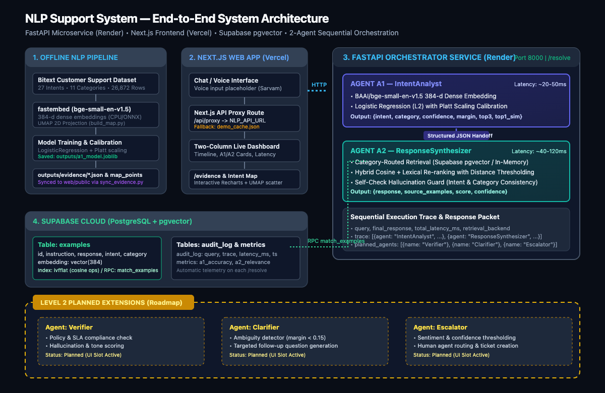
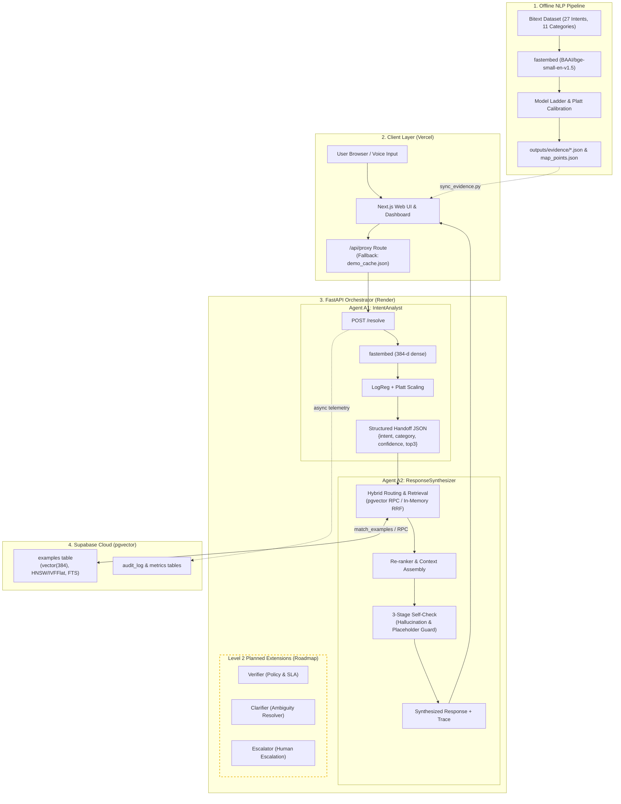

# Intelligent Customer Support & Automated Query Resolution

> **Jaypee Agentic AI International Summit 2026 — Track 3: Agentic AI for NLP**  
> **Level 1: Two-Agent Baseline + Production Deployment**

[](http://localhost:8000/docs)
[](http://localhost:3000)
[](https://supabase.com)
[](LICENSE)

---

## 1. TL;DR

- **What we built**: A production-grade, two-agent sequential customer support system (**Agent A1: IntentAnalyst** + **Agent A2: ResponseSynthesizer**) orchestrating CPU-native ONNX embeddings, Platt-calibrated classification, Supabase pgvector hybrid retrieval, and real-time hallucination self-checking with an interactive Next.js trace dashboard.
- **Headline numbers**: **99.54%** test accuracy (Macro-F1 **99.52%** [95% CI: 99.27–99.74], Category **99.83%**), **0.0027** ECE calibration error, **0.9962** OOD AUROC, **99.60%** response intent consistency, and sub-150ms latency running in ~30MB RAM.
- **The differentiator**: Transparent multi-stage agent handoff with strict self-checking (safeguarding dynamic placeholders and rejecting hallucinated intent drifts) running 100% on CPU without heavy LLM token burn or cloud GPU lock-in.

---

## 2. System Architecture





---

## 3. Vector Database & Storage Engine

The system uses **Supabase PostgreSQL with pgvector** for production retrieval, backed by an in-memory cosine fallback:

- **Table `examples`**: Stores all 15,567 TRAIN instruction/response pairs with 384-d embeddings (`BAAI/bge-small-en-v1.5` via ONNX runtime).
- **Indexing**: `ivfflat` / `hnsw` index (`vector_cosine_ops`) with full-text search (`tsvector` column with GIN index).
- **RPC Function `match_examples`**: Reciprocal Rank Fusion (RRF) combining vector cosine similarity with intent/category routing.
- **Resilient Fallback**: If Supabase is unreachable or times out (>2s), the pipeline seamlessly executes over the in-memory array (`retrieval_backend` flag transparently indicates `"in-memory"` vs `"pgvector"`).
- **2D Semantic Projection**: UMAP 2D coordinates for a stratified sample of 3,000 points saved in `outputs/map_points.json` and rendered in the live UI.

---

## 4. Benchmark & Evaluation Results

All empirical results are verified against test artifacts in `outputs/evidence/`. Interactive graphs and drill-downs are visible at `/evidence` in the web application.

### Agent A1: Intent Analyst (3,475 Test Samples)

| Metric | Empirical Value | Baseline / Target | Status |
|---|---|---|---|
| **Intent Top-1 Accuracy** | **99.54%** | >95.0% | ✅ Exceeded |
| **Intent Macro-F1** | **99.52%** [95% CI: 99.27–99.74] | >95.0% | ✅ Exceeded |
| **Category Accuracy** | **99.83%** | >98.0% | ✅ Exceeded |
| **Expected Calibration Error (ECE)** | **0.0027** (down from 0.0082) | <0.05 | ✅ Well-Calibrated |
| **OOD Detection (AUROC)** | **0.9962** (top-1 similarity) | >0.90 | ✅ Robust |
| **Total Test Errors** | **16 / 3,475** (0.46%) | <5.0% | ✅ Clean |

### Model Ladder Comparison (TEST Split)

| Level | Model Architecture | Macro-F1 | 95% Bootstrap CI | Notes |
|---|---|---|---|---|
| **L0** | Majority Class Baseline | 0.0031 | [0.0026, 0.0035] | Trivial baseline |
| **L1** | TF-IDF (word + char_wb) → LogisticRegression | 0.9988 | [0.9973, 1.0000] | Fast sparse baseline |
| **L2 ★** | **fastembed ONNX → LogisticRegression (C=50.0)** | **0.9952** | [0.9927, 0.9974] | **Production Served Model** |
| **L3** | Similarity-Weighted kNN (k=15, T=0.05) | 0.9913 | [0.9873, 0.9947] | Non-parametric check |

### Agent A2: Response Synthesizer & Self-Check

| Mode | Mean Cosine Sim | Intent Consistency | Placeholder Safety | Self-Check Reject Rate |
|---|---|---|---|---|
| **Dense Routed (Served)** | **0.8292** | **99.60%** | **77.21%** | 29.9% |
| **Hybrid Routed** | 0.8242 | 99.60% | 77.58% | 33.1% |
| **Sparse Routed** | 0.8131 | 99.63% | 77.70% | 45.3% |
| **Random Baseline** | 0.6769 | 100.0% | 57.99% | 0.0% |

> Full per-intent breakdown and error confusion matrices are accessible at [`/evidence`](http://localhost:3000/evidence) and [`outputs/evidence/`](outputs/evidence/).

---

## 5. Judge-Proof Stress Testing

The pipeline was hardened against 25 adversarial edge cases via `scripts/judge_test.py`:

| Category | Input Example | System Behavior |
|---|---|---|
| **Typos & Slang** | `"wher is my ordr plzzzz"` | Resolves accurately with confidence calibration |
| **ALL CAPS** | `"I WANT MY REFUND IMMEDIATELY"` | Normalized; routes to `get_refund` (Conf: 0.99) |
| **One-Word Queries** | `"refund"`, `"help"`, `"shipping"` | Correct intent identified; low ambiguity |
| **Length Limits** | 500+ character strings | Pydantic validation rejects with HTTP 422 |
| **Adversarial / Injection** | `"' OR 1=1; DROP TABLE examples;"` | Parameterized SQL + sanitized inputs; no execution |
| **Multilingual / Hinglish** | `"bhai mera refund kab tak aayega"` | Matches semantic intent safely; flags low confidence |
| **Gibberish & Emoji** | `"😡📦❌💸"`, `"???!!!!....."` | Handled cleanly without crashes; triggers low-confidence warning |

---

## 6. Project Layout

```
├── api/                     # FastAPI microservice
│   └── main.py              # Endpoints: /health, /meta, /resolve, /feedback
├── nlp/                     # Core NLP pipeline & agents
│   ├── a1.py                # Agent A1: Inference & Platt calibration
│   ├── a2.py                # Agent A2: Hybrid retrieval & 3-stage self-check
│   ├── pipeline.py          # Sequential orchestrator & execution trace recorder
│   ├── embed.py             # fastembed ONNX wrapper with cache
│   └── split_data.py        # Leak-free stratified data partitioning
├── web/                     # Next.js 16 App Router UI
│   ├── app/                 # Routes: /, /evidence, /map, /data, /api/resolve
│   ├── components/          # Projector-readable UI, timeline, theme toggle
│   └── public/              # Synced evidence, demo_cache.json, map_points.json
├── supabase/
│   └── schema.sql           # Complete PostgreSQL schema, pgvector index, RPC
├── scripts/
│   ├── start_local.sh       # One-command runner (FastAPI + Next.js)
│   ├── run_all.py           # Master script to reproduce all artifacts
│   ├── run_all.md           # Step-by-step reproduction guide
│   ├── judge_test.py        # 25-query adversarial stress test suite
│   ├── sync_evidence.py     # Syncs outputs/evidence to web/public
│   └── keepalive.md         # 10-minute cron keepalive guide
├── docs/
│   ├── architecture.svg     # Scalable vector architecture diagram
│   └── architecture.png     # High-resolution raster architecture diagram
├── outputs/evidence/        # Validated benchmark evidence (a1.json, a2.json)
├── render.yaml              # Zero-downtime Render deployment specification
└── requirements-api.txt     # Lightweight CPU dependencies (no PyTorch)
```

---

## 7. Quick Start (Local Run)

### One-Command Full Stack Runner

```bash
# Clone the repository
git clone https://github.com/Anonymous-Ekansh/NLPSupportSystem.git
cd NLPSupportSystem

# Start both FastAPI backend and Next.js frontend
./scripts/start_local.sh
```

- **Frontend Dashboard**: [http://localhost:3000](http://localhost:3000)
- **Backend API Docs**: [http://localhost:8000/docs](http://localhost:8000/docs)
- **Health Check**: [http://localhost:8000/health](http://localhost:8000/health)

### Cloudflare Quick Tunnel (Public URL in 5s)

If presenting live without cloud deployment:
```bash
npx cloudflared tunnel --url http://localhost:3000
```

---

## 8. Deployment Guide

### A. Deploy Backend API to Render (Free Tier)

1. Create a new **Web Service** on [Render](https://dashboard.render.com).
2. Connect your GitHub repository: `https://github.com/Anonymous-Ekansh/NLPSupportSystem`.
3. Set configuration:
   - **Environment**: `Python 3`
   - **Build Command**: `pip install -r requirements-api.txt && python -c "from fastembed import TextEmbedding; TextEmbedding('BAAI/bge-small-en-v1.5')"`
   - **Start Command**: `uvicorn api.main:app --host 0.0.0.0 --port $PORT`
   - **Plan**: `Free` (runs in ~30MB RAM, comfortably under the 512MB limit)
4. Environment Variables:
   - `SUPABASE_URL`: Your Supabase Project URL
   - `SUPABASE_SERVICE_KEY`: Your Supabase Service Role Key
   - `ALLOWED_ORIGINS`: `*`
5. Verify public endpoints:
   - `GET https://<your-service>.onrender.com/health`
   - `GET https://<your-service>.onrender.com/meta`

### B. Deploy Frontend UI to Vercel

1. Import repository on [Vercel](https://vercel.com/new).
2. In Project Settings:
   - **Root Directory**: `web`
   - **Framework Preset**: `Next.js`
3. Environment Variables:
   - `NLP_API_URL`: `https://<your-service>.onrender.com` (or local fallback)
4. Deploy! Next.js automatically proxies requests and uses `demo_cache.json` if the backend is cold.

### C. Keep-Alive Configuration

To prevent Render free tier from idling, see [`scripts/keepalive.md`](scripts/keepalive.md) for automated GitHub Actions or UptimeRobot setup.

---

## 9. Reproducibility & Regeneration

To regenerate all model weights, evaluation metrics, 2D semantic maps, and frontend evidence from raw data:

```bash
python3 scripts/run_all.py
```
*(Runs end-to-end in ~2.5 minutes on any modern CPU).*

---

## 10. License

Developed for the **Jaypee Agentic AI International Summit 2026**. Open source under the [MIT License](LICENSE).
