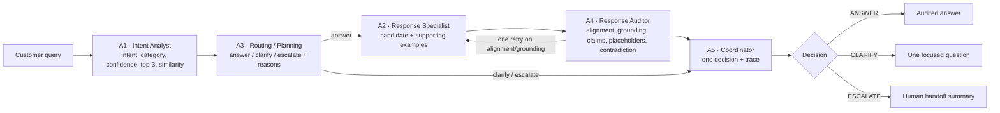

# ResolveIQ — Multi-Agent Customer Support

> **Jaypee Agentic AI International Summit 2026 — Track 3: Agentic AI for NLP**
> **Level 2: five-agent support system with ANSWER / CLARIFY / ESCALATE decisions and full agent traces**

[](http://localhost:8000/docs)
[](http://localhost:3000)
[](https://supabase.com)
[](#limitations)

---

## 1. What this is

A customer-support system that reads a customer question, retrieves a real past reply as
evidence, checks that reply before anyone sees it, and then makes **exactly one** decision:

| Decision | When it is chosen |
|---|---|
| **ANSWER** | Relevant evidence exists, confidence is high enough, and A4 accepted or safely revised the candidate. |
| **CLARIFY** | The request is ambiguous, or essential information (usually an order number) is missing. |
| **ESCALATE** | The request is out of scope, confidence is below the floor, the topic is sensitive (legal threat, fraud, harassment, self-harm), or a conflict between retrieved examples cannot be resolved. |

The system **never** claims that an order, payment, refund or account was actually changed.
No LLM is called at request time; every step is deterministic and every decision carries a trace.

The canonical example from the problem statement is a shipped test case:
`"I need a refund but cannot find my order number"` → **CLARIFY**, asking for the order number
(plus an alternative if the customer cannot find it) — never "your refund has been processed".

**Docs:** [Setup](SETUP.md) · [Decision policy](docs/DECISION_POLICY.md) · [Demo script](docs/DEMO_SCRIPT.md) ·
[Deliverables checklist](docs/DELIVERABLES.md) · [Day-1 audit](docs/L2_AUDIT.md) · [Reproduction guide](scripts/run_all.md)

---

## 2. Architecture


Editable vector source: [`docs/architecture.svg`](docs/architecture.svg) · PNG: [`docs/architecture.png`](docs/architecture.png)



### The five agents

| Agent | File | Input | Output | Why it exists |
|---|---|---|---|---|
| **A1 Intent Analyst** | [`nlp/a1.py`](nlp/a1.py) | query | `intent`, `category`, `confidence`, `margin`, `top3`, `top1_similarity`, `needs_clarification` | Says what the question is about and how sure it is. |
| **A2 Response Specialist** | [`nlp/a2.py`](nlp/a2.py) | query + A1 + A3 retrieval scope | `response`, `supporting_examples`, `retrieval_score`, self-check verdict | Retrieves a real answer instead of generating one, so answers are grounded. |
| **A3 Routing / Planning** | [`nlp/l2/a3.py`](nlp/l2/a3.py) | query + A1 | `RoutePlan`: `route` (`answer`/`clarify`/`escalate`), `reasons`, `reason_codes`, `retrieval` (`mode`, `k`, intents, widen), `missing_slots`, `clarify_options` | Decides whether answering is even allowed, and why. |
| **A4 Response Auditor** | [`nlp/l2/a4.py`](nlp/l2/a4.py) | query + A1 + plan + A2 | `AuditResult`: `verdict` (`accept`/`revise`/`flag`), per-check results, `issues`, `revised_response`, `retry_candidate_rank` | Catches unsupported claims and ungrounded text before it ships. |
| **A5 Coordinator** | [`nlp/a5.py`](nlp/a5.py) | all of the above | `FinalDecision`: `decision`, `response`, `intent`, `category`, `reason_codes`, `evidence_ids` + five `TraceStep`s | Owns the single user-visible outcome and the trace. |

Shared contracts (`RoutePlan`, `AuditResult`, `FinalDecision`, `TraceStep`) live in
[`nlp/l2/contracts.py`](nlp/l2/contracts.py); slot detection lives in
[`nlp/l2/slots.py`](nlp/l2/slots.py); thresholds live in
[`config/l2_policy.json`](config/l2_policy.json).

---

## 3. Decision policy

All thresholds come from one file, [`config/l2_policy.json`](config/l2_policy.json), which is
tuned on **DEV only** by [`scripts/tune_a3_policy.py`](scripts/tune_a3_policy.py) and never on TEST.
Current values:

| Setting | Value | Used by |
|---|---|---|
| `confidence_high` | 0.65 | A3 — above this, retrieval can proceed without asking |
| `confidence_low` | 0.60 | A3 / A5 — below this, escalate rather than guess |
| `top2_margin_min` | 0.05 | A3 — closer top-2 than this is ambiguity |
| `ood_similarity_min` | 0.55 | A3 — out of distribution below this similarity |
| `similarity_min` | 0.70 | A4 — minimum query-to-response cosine |
| `neighbor_agreement_min` | 0.60 | A4 — retrieved examples must agree on intent |
| `retrieval.mode` / `k` / `k_widened` | `hybrid` / 5 / 10 | A2 via A3 |
| `audit.grounding_jaccard_min` | 0.35 | A4 grounding check |

A3 rule order (first match wins, every branch appends a human-readable reason):
1. empty query → escalate (`empty_query`)
2. gibberish → escalate (`gibberish`)
3. sensitive terms (legal, fraud, harassment, self-harm) → escalate (`sensitive_content`)
4. out-of-distribution similarity → escalate (`out_of_distribution`)
5. required detail missing → clarify (`missing_information`, `user_lacks_slot`); how-to questions
   about the same intent are answered instead (`informational_question`)
6. low confidence → escalate (`low_confidence`)
7. close top-2 across categories → clarify (`ambiguous_intent`); same category → answer with
   widened retrieval (`widened_retrieval`)
8. otherwise → answer (`standard_retrieval`)

A5 then honours the plan. On the answer path it will only serve an audit that ended in
`accept` or `revise`; a still-flagged candidate becomes CLARIFY (alignment), ESCALATE
(contradiction) or ESCALATE (grounding/claims). An unaudited candidate is never served.

The full table, including every reason code and the escalation queues, is in
[`docs/DECISION_POLICY.md`](docs/DECISION_POLICY.md).

---

## 4. Data

Source: the **Bitext customer-support dataset** (templated English support utterances; each row
carries an `instruction`, `response`, `category`, `intent` and a `flags` string).

| Fact | Value | Source |
|---|---|---|
| Raw rows in the provided files | **22,841** (18,810 `data/train.csv` + 4,031 `data/validation.csv`) | files themselves |
| Splits after dedup + leak removal | **15,567 train / 1,730 dev / 3,475 test** | `outputs/splits/`, `nlp/split_data.py` |
| Intents | **27** exact labels | `outputs/splits/train.csv` |
| Categories | **11** exact labels | `outputs/splits/train.csv` |

Category labels are spelled as they appear in the provided CSVs (`CANCEL`, `SHIPPING`,
`FEEDBACK` …), which are **not** the official Bitext README spellings
(`CANCELLATION_FEE`, `SHIPPING_ADDRESS` …). The code and the submission CSV use the provided
spellings.

| Category | Train rows | Intents in it |
|---|---|---|
| `ACCOUNT` | 3,469 | 6 — `create_account`, `delete_account`, `edit_account`, `recover_password`, `registration_problems`, `switch_account` |
| `ORDER` | 2,028 | 4 — `cancel_order`, `change_order`, `place_order`, `track_order` |
| `REFUND` | 1,659 | 3 — `check_refund_policy`, `get_refund`, `track_refund` |
| `FEEDBACK` | 1,256 | 2 — `complaint`, `review` |
| `PAYMENT` | 1,253 | 2 — `check_payment_methods`, `payment_issue` |
| `CONTACT` | 1,242 | 2 — `contact_customer_service`, `contact_human_agent` |
| `SHIPPING` | 1,229 | 2 — `change_shipping_address`, `set_up_shipping_address` |
| `INVOICE` | 1,155 | 2 — `check_invoice`, `get_invoice` |
| `DELIVERY` | 1,056 | 2 — `delivery_options`, `delivery_period` |
| `SUBSCRIPTION` | 626 | 1 — `newsletter_subscription` |
| `CANCEL` | 594 | 1 — `check_cancellation_fee` |

Note the dataset's own quirk: `cancel_order` is in **ORDER**, and the `CANCEL` category holds
only `check_cancellation_fee`. The dataset's `flags` letters mark language variations
(politeness, colloquialism, typos, …); they are used **only** for analysis slices, never as a
prediction or routing signal.

---

## 5. Results

### Day 1 (also the baseline reproduced by `resolve(..., baseline=True)`)

Measured on the 3,475-row TEST split; raw evidence in
[`outputs/evidence/a1.json`](outputs/evidence/a1.json) and
[`outputs/evidence/a2.json`](outputs/evidence/a2.json).

| A1 metric | Value |
|---|---|
| Intent top-1 accuracy | **99.54%** |
| Intent macro-F1 | **99.52%** (95% CI 99.27–99.74) |
| Category accuracy | **99.83%** |
| Test errors | **16 / 3,475** |
| Calibration (ECE) | **0.0027** |
| OOD AUROC (top-1 similarity) | **0.9962** |

| A2 mode (TEST) | Mean cosine | ROUGE-L | Intent consistency | Self-check pass |
|---|---|---|---|---|
| `dense_routed` (served) | 0.8292 | 0.3373 | 0.9960 | 0.7085 |
| `sparse_routed` | 0.8131 | 0.3285 | 0.9963 | 0.6547 |
| `dense_global` | 0.8394 | 0.3499 | 0.9983 | — |

### Level 2

> **Numbers below are placeholders on purpose.** They are produced by the final evaluation
> run and must be copied from the evidence files, not typed from memory.

| Result | Value | Fill from |
|---|---|---|
| Intent accuracy on the held-out sample | `PENDING` | `outputs/evidence/robustness.json` → `overall.intent_accuracy` |
| Intent macro-F1 | `PENDING` | `robustness.json` → `overall.intent_macro_f1` |
| Category accuracy | `PENDING` | `robustness.json` → `overall.category_accuracy` |
| Day-1 parity check | `PENDING` | `robustness.json` → `overall.matches_day1_within_0.01` |
| Decision distribution (ANSWER / CLARIFY / ESCALATE) | `PENDING` | `robustness.json` → `overall.decisions` |
| Coverage / accuracy on answered | `PENDING` | `robustness.json` → `selective_prediction` |
| False action claims in ANSWER outputs | `PENDING` | `robustness.json` → `false_action_claims` |
| Stress-set routing (ambiguous, missing slot, out of scope, weak evidence, contradiction) | `PENDING` | `robustness.json` → `stress_sets`, `ablation_day1_vs_l2` |
| Warm latency p50 / p95 | `PENDING` | `outputs/submission/submission_report.json` → `latency_ms` |

The `/robustness` page in the web app renders exactly these files, so a stale number is visible
rather than hidden.

---

## 6. Robustness testing

[`nlp/perturb.py`](nlp/perturb.py) applies **seeded, deterministic** transformations so results are
reproducible from a clean checkout:

| Perturbation | What it does | Notes |
|---|---|---|
| `typo` | character-level edits inside words | seeded per string |
| `swap` | adjacent character transpositions | |
| `abbrev` | expands `pls`, `ord`, `acct`, `w/o`, … | only where a rewrite exists |
| `slang` | colloquial rewrites (`wanna`, `gonna`, `kinda`) | |
| `caps` | upper-cases the whole query | |
| `no_punct` | strips punctuation | |
| `hinglish` | small template set (`bhai mera refund kab aayega …`) | synthetic |

**These perturbations are synthetic, and their labels are inherited from the original TEST row.**
They measure robustness of the *classifier and the routing layer*; they are not new ground truth.
The dataset's own `flags` letters are also reported as separate slices.

[`scripts/eval_l2.py`](scripts/eval_l2.py) additionally builds targeted stress sets — ambiguous
two-intent blends, missing-slot requests, out-of-scope questions, contradictory retrieved
evidence, weak evidence — and reports how often each was correctly routed versus wrongly
answered, plus a Day-1-vs-Level-2 ablation on the same cases. Sample sizes are printed with
every group and groups under 30 are marked `low_sample`.

Run it with:

```bash
.venv/bin/python scripts/eval_l2.py --n 500 --n-pert 100 --seed 13
```

It writes `outputs/evidence/robustness.json`, `l2_decisions.json` and `trace_examples.json`
(revise / clarify / escalate), then copies them to `web/public/evidence/` with `--sync`.

---

## 7. Run it

```bash
git clone https://github.com/Anonymous-Ekansh/NLPSupportSystem.git
cd NLPSupportSystem
./scripts/start_local.sh          # API :8000 + UI :3000
```

Full instructions — install, model artifacts, CLI, batch mode, submission generation,
validation, tests, troubleshooting — are in **[SETUP.md](SETUP.md)**.

Quick API check:

```bash
curl -s -X POST http://localhost:8000/resolve \
  -H 'Content-Type: application/json' \
  -d '{"query":"I need a refund but cannot find my order number"}'
```

CLI:

```bash
.venv/bin/python -m nlp.cli "I need a refund but cannot find my order number"
.venv/bin/python -m nlp.cli --json "where is my order"
.venv/bin/python -m nlp.cli --follow-up "123456" "I need a refund but cannot find my order number"
```

---

## 8. Submission artifacts

`scripts/make_submission.py` samples the TEST split with a fixed seed and writes
`outputs/submission/`:

| File | Contents |
|---|---|
| `queries.csv` | `query_id` (`Q001`…), `query` |
| `gold.csv` | `query_id`, `query`, `intent`, `category`, `response`, `flags` |
| `predictions.csv` | exactly `query_id,predicted_intent,predicted_category,decision` |
| `responses.jsonl` | generated/selected response per query, separate from the CSV |
| `traces.jsonl` | full five-agent trace per query, separate from the CSV |
| `submission_report.json` | sampled accuracy, decision counts, latency |

Validate before handing it in:

```bash
.venv/bin/python scripts/validate_submission.py \
  outputs/submission/predictions.csv --gold outputs/submission/gold.csv
```

The validator checks the exact header order, unique ids, exact dataset intent/category labels,
and that every decision is one of ANSWER / CLARIFY / ESCALATE.

---

## 9. Repository layout

```
├── api/main.py                  # FastAPI: /health, /meta, /resolve, /resolve/batch, /feedback
├── nlp/
│   ├── a1.py                    # A1 intent + calibration
│   ├── a2.py                    # A2 retrieval + 3-stage self-check
│   ├── a5.py                    # A5 coordinator
│   ├── pipeline.py              # Level2Pipeline (A1→A3→A2→A4→A5, plus baseline flag)
│   ├── cli.py                   # single query, follow-up, batch
│   ├── perturb.py               # seeded perturbations + dataset flag groups
│   ├── l2/
│   │   ├── a3.py                # A3 routing planner
│   │   ├── a4.py                # A4 auditor
│   │   ├── contracts.py         # RoutePlan / AuditResult / FinalDecision / TraceStep
│   │   ├── slots.py             # required-detail detection
│   │   └── policy.py            # policy loader
│   └── split_data.py            # leak-free splits
├── config/l2_policy.json        # every threshold, tuned on DEV
├── scripts/                     # training, evaluation, submission, sync, dev helpers
├── tests/                       # test_a4.py, test_pipeline_l2.py (script-style, exit 0 = pass)
├── web/                         # Next.js 14 app: /, /results, /architecture, /data, /robustness
├── docs/                        # architecture, audit, decision policy, demo script, deliverables
├── outputs/                     # models, splits, metrics, evidence, submission
├── supabase/schema.sql          # pgvector schema + RPC
└── requirements-nlp.txt · requirements-api.txt
```

---

## 10. Limitations

- **Templated corpus.** Bitext is machine-generated from templates, so TEST accuracy is
  optimistic for real chat traffic. The robustness slices exist to show where that breaks down.
- **Synthetic perturbations are synthetic.** Their labels are inherited; expectations in the
  stress sets are our definitions, not dataset truth. They are marked as such in the output.
- **No action is ever executed.** The system retrieves and explains policy; it cannot refund,
  cancel or update anything, and it is built never to imply otherwise.
- **Extractive, not generative.** Answers are selected from the dataset and checked, so wording
  is inherited from the corpus rather than composed per customer.
- **Retrieval backend differs by path.** The API can serve from Supabase pgvector with an
  in-memory fallback; `/health` and every response report which one answered. The evaluation
  scripts run on the in-memory index.
- **Small stress sets.** Some groups have fewer than 30 cases and are labelled `low_sample`;
  read their percentages as directional.
- **Confidence is quantised.** A1's calibrated confidence saturates near 1.0 on easy rows, so a
  confidence-only risk/coverage curve is flat; routing additionally uses slots, OOD similarity
  and top-2 margin.

---

## 11. License

Built for the Jaypee Agentic AI International Summit 2026. MIT.
